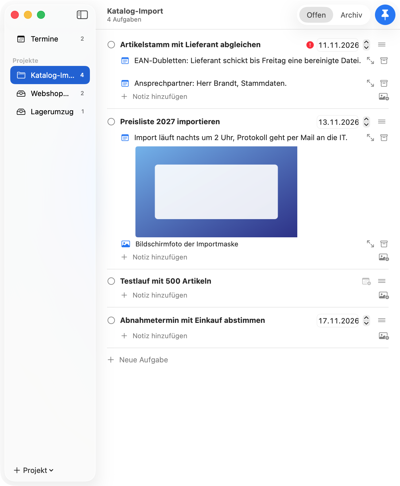

# Merkzettel

Kompakte macOS-App für Projektmanager: Projekte links, Aufgaben als Überschriften mit Notizen und Bildern rechts, Termine über alle Projekte, Archiv, Fenster immer im Vordergrund.



## Funktionen

- **Projekte:** neu anlegen oder bestehende Finder-Ordner wählen. In den Einstellungen lässt sich ein Stammordner festlegen; jedes neue Projekt bekommt dort einen Unterordner.
- **Aufgaben:** jede Aufgabe ist eine Überschrift. Reihenfolge = Priorität, änderbar durch Ziehen am Griff rechts auf eine andere Aufgabe.
- **Notizen:** hängen unter ihrer Aufgabe, in der Liste höchstens drei Zeilen, per Symbol in einem eigenen großen Fenster zu öffnen.
- **Bilder:** als Notiz einfügen, aus der Zwischenablage, als Datei oder per Ziehen auf die Aufgabe.
- **Termine:** Datumsfeld rechts neben der Aufgabe. Der Punkt „Termine" in der Seitenleiste zeigt alle datierten Aufgaben aller Projekte, gruppiert nach Überfällig, Heute, Nächste 7 Tage, Später. Ein Klick springt zur Aufgabe.
- **Archiv:** der Kreis vor der Aufgabe fragt nach und schiebt sie mit ihren Notizen ins Archiv. Einzelne Notizen lassen sich ebenfalls abschließen. Aus dem Archiv lässt sich alles zurückholen.
- **Archiv-Datei:** hat ein Projekt einen Ordner, schreibt die App das Archiv dort als `Merkzettel-Archiv.md`, Bilder daneben in `Merkzettel-Bilder`.
- **Obsidian:** In den Einstellungen lässt sich ein Obsidian-Vault verknüpfen. Jedes Projekt wird dort eine Markdown-Notiz mit offenen Aufgaben als Kästchen (Termin im Format des Tasks-Plugins), Notizen, Bildern und Archiv. Die Richtung ist Merkzettel nach Obsidian.
- **Immer im Vordergrund:** Stecknadel in der Symbolleiste (Umschalt-Command-T), optional auf allen Schreibtischen.
- **Listen einfügen:** Umschalt-Command-V macht aus jeder Zeile der Zwischenablage eine Aufgabe.

## Voraussetzungen

macOS 26 oder neuer, Xcode 26 (Swift 6.2 oder neuer). Es gibt kein Xcode-Projekt, nur ein Swift-Paket.

## Bauen und starten

```bash
./build.sh --open
```

Das Skript baut, signiert (ad hoc, wenn kein Entwicklerzertifikat vorhanden ist) und installiert nach `~/Applications/Merkzettel.app`.

Prüfen:

```bash
swift test --scratch-path ~/Library/Developer/Merkzettel/test-build
tools/selftest.sh
tools/snap.sh
```

## Wo die Daten liegen

`~/Library/Application Support/Merkzettel/Merkzettel.store` (SwiftData). Projektordner enthalten nur die Archiv-Datei und deren Bilder.

## Aufbau

- `Sources/Merkzettel/` die App: `App.swift` (Fenster, Menüs), `Models.swift` (Datenmodell und alle Aktionen), `ContentView.swift` (Oberfläche), `SettingsView.swift`.
- `Sources/MerkzettelKit/` Logik ohne SwiftUI: Listen-Parser, Termin-Gruppen, Archiv-Dokument. Tests in `Tests/`.
- `CLAUDE.md` Regeln für das Arbeiten am Projekt mit Claude Code.

## Prompt zum Nachbauen mit Claude Code

Den folgenden Text in einer neuen Claude-Code-Sitzung in einem leeren Ordner einfügen:

```text
Baue mir eine native macOS-App „Merkzettel" in SwiftUI mit SwiftData, als Swift-Paket
ohne Xcode-Projekt, für macOS 26. Oberfläche auf Deutsch. Ein Build-Skript soll die App
bauen, ad hoc signieren und nach ~/Applications installieren.

Zweck: Ich bin Projektmanager und will pro Projekt kompakt Aufgaben und Notizen führen.

Fenster
- Kompaktes Fenster (Standard ca. 640 x 560, Minimum 440 x 320) mit Seitenleiste links
  und Inhalt rechts.
- Stecknadel in der Symbolleiste: Fenster bleibt immer im Vordergrund (Fensterebene
  „floating"), Zustand wird gemerkt. Einstellung: zusätzlich auf allen Schreibtischen zeigen.

Seitenleiste
- Oben der Punkt „Termine" mit Zähler für heute fällige und überfällige Aufgaben.
- Darunter die Projekte, per Ziehen sortierbar, mit Zähler der offenen Aufgaben.
- Unten ein Menü „+ Projekt": „Neues Projekt" (Name direkt in der Seitenleiste tippen)
  und „Bestehenden Ordner wählen …" (ein oder mehrere Finder-Ordner, Projekt heißt wie
  der Ordner). Rechtsklick: Umbenennen, Im Finder zeigen, Projekt löschen (mit Rückfrage,
  der Ordner bleibt).

Projektseite
- Jede Aufgabe ist eine fette Überschrift mit: Kreis links (erledigen), Datumsfeld rechts
  (Kalender-Symbol setzt heute, danach kompaktes Datumsfeld im Format TT.MM.JJJJ, rotes
  Ausrufezeichen wenn überfällig), Griff-Symbol ganz rechts.
- Unter der Aufgabe eingerückt ihre Notizen und ein Feld „Notiz hinzufügen"; Return fügt
  hinzu und lässt den Cursor im Feld. Der Block muss mit jeder Notiz mitwachsen: dafür
  ScrollView mit VStack verwenden, keine List (deren Zeilen wachsen beim Tippen nicht).
- Notizen zeigen in der Liste höchstens drei Zeilen. Ein Symbol öffnet die Notiz in einem
  eigenen, frei vergrößerbaren Fenster mit Texteditor.
- Bilder als Notiz: Knopf neben „Notiz hinzufügen" fügt das Bild aus der Zwischenablage
  ein, sonst Dateiauswahl; außerdem Bilddateien oder Bilder auf die Aufgabe ziehen.
  Bild mit Bildunterschrift anzeigen, Doppelklick öffnet es groß.
- Priorität: Aufgabe am Griff auf eine andere Aufgabe ziehen, sie nimmt deren Platz ein.
  Auf eine Aufgabe gezogener Text wird zur Notiz.
- Ganz unten „Neue Aufgabe". Mehrere Zeilen (z. B. per Befehl „Zeilen aus der
  Zwischenablage als Aufgaben einfügen", Umschalt-Command-V) werden zu mehreren Aufgaben;
  Aufzählungszeichen, Nummern und Kästchen am Zeilenanfang werden entfernt.
- Umschalter in der Symbolleiste: Offen | Archiv.

Erledigen und Archiv
- Klick auf den Kreis öffnet eine Rückfrage „Aufgabe erledigt?"; erst nach Bestätigung
  wandert die Aufgabe mit allen Notizen ins Archiv.
- Einzelne Notizen lassen sich über ein Archiv-Symbol abschließen.
- Das Archiv zeigt erledigte Aufgaben mit ihren Notizen und Datum, neueste zuerst;
  zurückholen, endgültig löschen, Archiv leeren (mit Rückfrage).

Termine
- Zeigt alle offenen Aufgaben mit Datum aus allen Projekten, gruppiert nach Überfällig,
  Heute, Nächste 7 Tage, Später, mit Projektname. Ein Klick springt zur Aufgabe im
  Projekt, scrollt hin und markiert sie kurz.

Projektordner und Archiv-Datei
- Einstellung „Ordner für neue Projekte": Jedes neue Projekt bekommt dort einen
  Unterordner mit seinem Namen (/ und : durch - ersetzen; bei Namensgleichheit „Name 2").
- Hat ein Projekt einen Ordner, schreibt die App das Archiv bei jeder Änderung als
  „Merkzettel-Archiv.md" dorthin (Aufgabe als Überschrift mit Erledigt-Datum und Termin,
  Notizen als Liste), Bilder nach „Merkzettel-Bilder". Abschaltbar in den Einstellungen.

Obsidian
- Eigener Einstellungs-Reiter „Obsidian": Schalter „Projekte in Obsidian ablegen", Auswahl
  des Vaults (bekannte Vaults aus ~/Library/Application Support/obsidian/obsidian.json,
  sonst Ordner wählen), Ordner im Vault (Standard „Merkzettel"), Schalter „Archiv mit
  aufnehmen", Anzeige des letzten Schreibzeitpunkts oder Fehlers, Knopf „Jetzt schreiben".
- Je Projekt eine Markdown-Notiz im Vault: Frontmatter mit Tag „merkzettel", Hinweis, dass
  die Notiz überschrieben wird, offene Aufgaben als „- [ ]" in Prioritätsreihenfolge mit
  Termin als „📅 JJJJ-MM-TT", Notizen eingerückt darunter, Bilder als ![[Datei]] aus dem
  Unterordner „Anhänge", danach das Archiv mit „- [x] … ✅ JJJJ-MM-TT".
- Nur Richtung Merkzettel nach Obsidian. Etwa eine Sekunde nach jeder Änderung schreiben,
  Dateien nur bei geändertem Inhalt anfassen. Umbenannte Projekte nehmen ihre Notiz mit.
- „In Obsidian öffnen" im Rechtsklick-Menü des Projekts und als Menübefehl
  (obsidian://open?path=…).
- Ein Zahnrad unten in der Seitenleiste öffnet die Einstellungen.

Technik
- Datenmodell: Project (Name, Ordnerpfad, Reihenfolge) und Entry (Text, Art Aufgabe oder
  Notiz, archiviert, Archivdatum, Fälligkeitsdatum, Reihenfolge, Bild als externe Daten,
  Verweis auf die Aufgabe, zu der eine Notiz gehört; Löschen einer Aufgabe löscht ihre Notizen).
- Reine Logik (Listen-Parser, Termin-Gruppen, Markdown des Archivs, Ordnernamen) in ein
  eigenes Modul ohne SwiftUI mit Unit-Tests.
- Ein Selbsttest (--selftest) prüft die Aktionen auf einer Test-Datenbank in /tmp.
- Jede Aktion hat einen Menübefehl mit Tastenkürzel. Systemfarben und Systemschriften,
  hell und dunkel.

Baue, starte die App und prüfe sie, bevor du fertig meldest.
```
